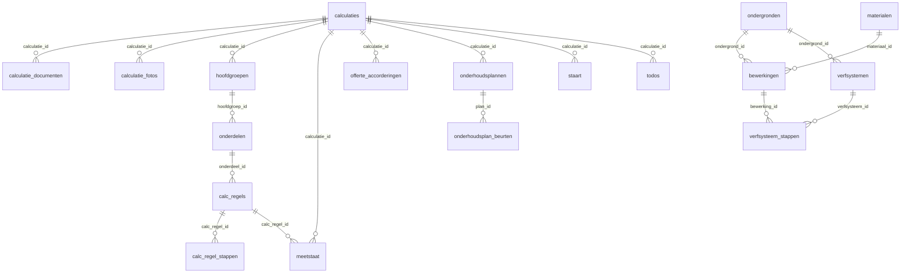

# Schilders Calc, datadictionary

> Database-structuur van de Supabase-backend (`schilders-calc`, schema `public`).
> Gegenereerd uit de live Supabase-structuur: 23 tabellen, 238 kolommen, 18 foreign keys.
> Bron: de twee SQL-uitdraaien uit Supabase Studio. Bij twijfel is de database de waarheid.

---

## Lees dit eerst: drie observaties

1. **Twee instellingen-tabellen.** `app_settings` is de actieve (één rij, alles in een jsonb-veld `data`). Daarnaast staat er nog een oude `settings`-tabel met losse kolommen zoals `uurloon` en `btw`. Die wordt door de code niet meer aangeroepen. Het is legacy. Niet weggooien zonder eerst te controleren of er geen Edge Function of script nog op leunt.

2. **Snapshots hebben bewust geen foreign key.** In `calc_regels` (systeem_id, systeem_ondergrond_id) en in `calc_regel_stappen` (bewerking_id, materiaal_id) staan wel verwijzende id's, maar er is geen foreign key op gezet. Dat is opzet: een calculatieregel is een bevroren kopie. Wijzig je later een verfsysteem of materiaal in de bibliotheek, dan mag een bestaande calculatie niet meeveranderen. Reken hier niet op een join die de database afdwingt.

3. **`calculaties` is de spil.** Bijna alles hangt direct of indirect aan een calculatie. Begrijp die tabel eerst, dan valt de rest op zijn plek.

---

## Hoe de tabellen samenhangen

De calculatieboom is drie niveaus diep: `calculaties` boven, dan `hoofdgroepen`, dan `onderdelen`, dan `calc_regels`. Aan een calculatieregel hangen de bevroren `calc_regel_stappen`. Daarnaast hangen direct aan een calculatie: de meetstaat, de staartkosten, foto's, documenten, to-dos, de offerte-accordering en het onderhoudsplan. Een onderhoudsplan heeft zijn eigen beurten.

De stamdata staat hier los van. `bewerkingen` verwijst naar een ondergrond en een materiaal. Een `verfsysteem` verwijst naar een ondergrond, en de stappen van dat systeem verwijzen naar bewerkingen. Die bibliotheek voedt de calculatie, maar via snapshots, niet via harde sleutels.

---

## Tabellen per onderdeel

### Stamdata en bibliotheken

#### `materialen`

Verf- en materiaalbibliotheek. Stamdata.

*Hieraan gekoppeld:* `bewerkingen.materiaal_id`.

| Kolom | Type | Leeg toegestaan | Default | Verwijst naar |
|---|---|---|---|---|
| `id` | uuid | nee | gen_random_uuid() | PK |
| `naam` | text | nee |  |  |
| `merk` | text | ja | ''::text |  |
| `type` | text | ja | ''::text |  |
| `groep` | text | ja | ''::text |  |
| `eenheid` | text | ja | 'L'::text |  |
| `prijs_per` | numeric | ja | 0 |  |
| `rendement` | numeric | ja | 0 |  |
| `created_at` | timestamp with time zone | ja | now() |  |
| `updated_at` | timestamp with time zone | ja | now() |  |

#### `ondergronden`

Soorten ondergrond, zoals hout, muur of staal. Stamdata.

*Hieraan gekoppeld:* `bewerkingen.ondergrond_id`, `verfsystemen.ondergrond_id`.

| Kolom | Type | Leeg toegestaan | Default | Verwijst naar |
|---|---|---|---|---|
| `id` | uuid | nee | gen_random_uuid() | PK |
| `naam` | text | nee |  |  |
| `locatie` | text | nee | 'beide'::text |  |
| `volgorde` | integer | nee | 0 |  |
| `created_at` | timestamp with time zone | ja | now() |  |
| `updated_at` | timestamp with time zone | ja | now() |  |

#### `bewerkingen`

Werkhandelingen met norm-minuten en verbruik, gekoppeld aan een ondergrond en eventueel een materiaal. Stamdata.

*Hieraan gekoppeld:* `verfsysteem_stappen.bewerking_id`.

| Kolom | Type | Leeg toegestaan | Default | Verwijst naar |
|---|---|---|---|---|
| `id` | uuid | nee | gen_random_uuid() | PK |
| `ondergrond_id` | uuid | ja |  | `ondergronden.id` |
| `naam` | text | nee |  |  |
| `eenheid` | text | ja | 'm²'::text |  |
| `minuten` | numeric | ja | 0 |  |
| `materiaal_id` | uuid | ja |  | `materialen.id` |
| `verbruik` | numeric | ja | 0 |  |
| `volgorde` | integer | nee | 0 |  |
| `created_at` | timestamp with time zone | ja | now() |  |
| `updated_at` | timestamp with time zone | ja | now() |  |
| `bron` | text | ja | 'eigen'::text |  |

#### `verfsystemen`

Een benoemd verfsysteem per ondergrond: een vaste reeks bewerkingen die samen één afwerking vormen. Stamdata.

*Hieraan gekoppeld:* `verfsysteem_stappen.verfsysteem_id`.

| Kolom | Type | Leeg toegestaan | Default | Verwijst naar |
|---|---|---|---|---|
| `id` | uuid | nee | gen_random_uuid() | PK |
| `ondergrond_id` | uuid | ja |  | `ondergronden.id` |
| `naam` | text | nee |  |  |
| `eenheid` | text | ja | 'm²'::text |  |
| `created_at` | timestamp with time zone | ja | now() |  |
| `updated_at` | timestamp with time zone | ja | now() |  |
| `notities` | text | ja | ''::text |  |

#### `verfsysteem_stappen`

De stappen binnen een verfsysteem. Elke stap verwijst naar een bewerking, met een percentage om de stap af te schalen.

| Kolom | Type | Leeg toegestaan | Default | Verwijst naar |
|---|---|---|---|---|
| `id` | uuid | nee | gen_random_uuid() | PK |
| `verfsysteem_id` | uuid | nee |  | `verfsystemen.id` |
| `bewerking_id` | uuid | ja |  | `bewerkingen.id` |
| `percentage` | numeric | ja | 100 |  |
| `volgorde` | integer | nee | 0 |  |
| `created_at` | timestamp with time zone | ja | now() |  |

#### `staart_lib`

Bibliotheek met staartkosten-regels (sjablonen): reis, opslag, korting en dergelijke. Stamdata.

| Kolom | Type | Leeg toegestaan | Default | Verwijst naar |
|---|---|---|---|---|
| `id` | uuid | nee | gen_random_uuid() | PK |
| `naam` | text | nee |  |  |
| `type` | text | ja | 'vast'::text |  |
| `bedrag` | numeric | ja | 0 |  |
| `created_at` | timestamp with time zone | ja | now() |  |
| `eenheid` | text | ja | ''::text |  |
| `grondslag` | text | ja | ''::text |  |
| `hoeveelheid` | numeric | ja | 0 |  |
| `verstop_in_eenheidsprijs` | boolean | nee | false |  |
| `telt_in_werkdagen` | boolean | ja | false |  |

#### `offerte_teksten`

Tekstenbibliotheek voor de offertemodule. De vlaggen std_consument, std_vve en std_zakelijk bepalen welke variant standaard wordt gekozen per klanttype.

| Kolom | Type | Leeg toegestaan | Default | Verwijst naar |
|---|---|---|---|---|
| `id` | uuid | nee | gen_random_uuid() | PK |
| `sectie` | text | nee |  |  |
| `naam` | text | nee |  |  |
| `inhoud` | text | nee | ''::text |  |
| `volgorde` | integer | nee | 0 |  |
| `created_at` | timestamp with time zone | nee | now() |  |
| `std_consument` | boolean | nee | false |  |
| `std_vve` | boolean | nee | false |  |
| `std_zakelijk` | boolean | nee | false |  |

#### `app_settings`

Actieve instellingen, gedeeld door alle gebruikers. Eén rij. Alle tarieven en opties zitten in het jsonb-veld `data`.

| Kolom | Type | Leeg toegestaan | Default | Verwijst naar |
|---|---|---|---|---|
| `id` | uuid | nee | gen_random_uuid() | PK |
| `data` | jsonb | nee | '{}'::jsonb |  |
| `updated_at` | timestamp with time zone | ja | now() |  |

#### `settings`

LEGACY. Oude instellingen-tabel met losse kolommen. Wordt door de code niet meer aangeroepen (vervangen door app_settings). Staat er nog, maar is dood gewicht. Kandidaat om op te ruimen na controle.

| Kolom | Type | Leeg toegestaan | Default | Verwijst naar |
|---|---|---|---|---|
| `id` | integer | nee | 1 | PK |
| `uurloon` | numeric | ja | 75 |  |
| `reistijd_tarief` | numeric | ja | 60 |  |
| `km_tarief` | numeric | ja | 0.45 |  |
| `snelheid` | numeric | ja | 50 |  |
| `klein_mat` | numeric | ja | 4 |  |
| `afval` | numeric | ja | 1.5 |  |
| `arbo` | numeric | ja | 2 |  |
| `winst` | numeric | ja | 10 |  |
| `btw` | numeric | ja | 21 |  |
| `volle_dagen` | boolean | ja | true |  |
| `afrondings_drempel` | numeric | ja | 0.6 |  |
| `groep_opslagen` | jsonb | ja | '{}'::jsonb |  |
| `updated_at` | timestamp with time zone | ja | now() |  |

### Project (rond calculaties)

#### `calculaties`

De projectheader. Dit is de spil van de hele database. Bevat de status, de bevroren instellingen-snapshot, de bevroren totalen, het adres en de offerte-configuratie.

*Hieraan gekoppeld:* `calculatie_documenten.calculatie_id`, `calculatie_fotos.calculatie_id`, `hoofdgroepen.calculatie_id`, `meetstaat.calculatie_id`, `offerte_accorderingen.calculatie_id`, `onderhoudsplannen.calculatie_id`, `staart.calculatie_id`, `todos.calculatie_id`.

| Kolom | Type | Leeg toegestaan | Default | Verwijst naar |
|---|---|---|---|---|
| `id` | uuid | nee | gen_random_uuid() | PK |
| `naam` | text | ja | ''::text |  |
| `klant` | text | ja | ''::text |  |
| `status` | text | ja | 'concept'::text |  |
| `schilders` | integer | ja | 2 |  |
| `uur_dag` | numeric | ja | 8 |  |
| `reis` | numeric | ja | 0 |  |
| `volle_dagen_override` | boolean | ja |  |  |
| `notities` | text | ja | ''::text |  |
| `aangemaakt` | timestamp with time zone | ja | now() |  |
| `gewijzigd` | timestamp with time zone | ja | now() |  |
| `settings_snapshot` | jsonb | ja |  |  |
| `totaal_incl_btw` | numeric | ja |  |  |
| `opname_datum` | date | ja |  |  |
| `deadline_datum` | date | ja |  |  |
| `totaal_offerte_origineel` | numeric | ja |  |  |
| `postcode` | text | ja |  |  |
| `huisnummer` | text | ja |  |  |
| `offerte_config` | jsonb | nee | '{}'::jsonb |  |

#### `hoofdgroepen`

Hoofdgroepen binnen een calculatie. Niveau 1 van de calculatieboom.

*Hieraan gekoppeld:* `onderdelen.hoofdgroep_id`.

| Kolom | Type | Leeg toegestaan | Default | Verwijst naar |
|---|---|---|---|---|
| `id` | uuid | nee | gen_random_uuid() | PK |
| `calculatie_id` | uuid | nee |  | `calculaties.id` |
| `naam` | text | nee |  |  |
| `collapsed` | boolean | ja | false |  |
| `volgorde` | integer | nee | 0 |  |
| `created_at` | timestamp with time zone | ja | now() |  |
| `actief` | boolean | nee | true |  |

#### `onderdelen`

Onderdelen binnen een hoofdgroep. Niveau 2 van de calculatieboom.

*Hieraan gekoppeld:* `calc_regels.onderdeel_id`.

| Kolom | Type | Leeg toegestaan | Default | Verwijst naar |
|---|---|---|---|---|
| `id` | uuid | nee | gen_random_uuid() | PK |
| `hoofdgroep_id` | uuid | nee |  | `hoofdgroepen.id` |
| `naam` | text | nee |  |  |
| `collapsed` | boolean | ja | false |  |
| `volgorde` | integer | nee | 0 |  |
| `created_at` | timestamp with time zone | ja | now() |  |
| `actief` | boolean | nee | true |  |

#### `calc_regels`

De calculatieregels binnen een onderdeel. Niveau 3 van de boom. Het gekozen verfsysteem staat hier als snapshot-velden (systeem_naam, systeem_eenheid en dergelijke), bewust zonder foreign key.

*Hieraan gekoppeld:* `calc_regel_stappen.calc_regel_id`, `meetstaat.calc_regel_id`.

| Kolom | Type | Leeg toegestaan | Default | Verwijst naar |
|---|---|---|---|---|
| `id` | uuid | nee | gen_random_uuid() | PK |
| `onderdeel_id` | uuid | nee |  | `onderdelen.id` |
| `naam` | text | ja | ''::text |  |
| `hoeveelheid` | numeric | ja | 0 |  |
| `toeslag` | numeric | ja | 0 |  |
| `systeem_id` | uuid | ja |  |  |
| `systeem_naam` | text | ja | ''::text |  |
| `systeem_eenheid` | text | ja | 'm²'::text |  |
| `systeem_ondergrond` | text | ja | ''::text |  |
| `systeem_ondergrond_id` | uuid | ja |  |  |
| `systeem_locatie` | text | ja | 'beide'::text |  |
| `volgorde` | integer | nee | 0 |  |
| `created_at` | timestamp with time zone | ja | now() |  |
| `actief` | boolean | nee | true |  |

#### `calc_regel_stappen`

De bevroren stappen per calculatieregel. Een momentopname van het verfsysteem op het moment dat het in de regel werd gezet. De bewerking- en materiaalvelden zijn snapshots zonder foreign key.

| Kolom | Type | Leeg toegestaan | Default | Verwijst naar |
|---|---|---|---|---|
| `id` | uuid | nee | gen_random_uuid() | PK |
| `calc_regel_id` | uuid | nee |  | `calc_regels.id` |
| `bewerking_id` | uuid | ja |  |  |
| `bewerking_naam` | text | ja | ''::text |  |
| `bewerking_eenheid` | text | ja | ''::text |  |
| `minuten` | numeric | ja | 0 |  |
| `percentage` | numeric | ja | 100 |  |
| `materiaal_id` | uuid | ja |  |  |
| `materiaal_naam` | text | ja |  |  |
| `materiaal_eenheid` | text | ja |  |  |
| `materiaal_prijs` | numeric | ja | 0 |  |
| `materiaal_groep` | text | ja |  |  |
| `verbruik` | numeric | ja | 0 |  |
| `volgorde` | integer | nee | 0 |  |
| `created_at` | timestamp with time zone | ja | now() |  |

#### `meetstaat`

Meetregels per calculatie: hoogte, breedte, aantal en factor. Kan aan een calc_regel hangen. Het veld `tekening` bevat de kozijn-JSON.

| Kolom | Type | Leeg toegestaan | Default | Verwijst naar |
|---|---|---|---|---|
| `id` | uuid | nee | gen_random_uuid() | PK |
| `calculatie_id` | uuid | nee |  | `calculaties.id` |
| `calc_regel_id` | uuid | ja |  | `calc_regels.id` |
| `omschrijving` | text | ja | ''::text |  |
| `h_cm` | integer | ja | 0 |  |
| `b_cm` | integer | ja | 0 |  |
| `aantal` | integer | ja | 1 |  |
| `opmerking` | text | ja | ''::text |  |
| `volgorde` | integer | nee | 0 |  |
| `created_at` | timestamp with time zone | ja | now() |  |
| `factor` | numeric | nee | 1 |  |
| `tekening` | jsonb | ja |  |  |
| `bron` | text | ja |  |  |
| `bron_meetstaat_id` | uuid | ja |  |  |

#### `staart`

Staartkosten gekoppeld aan één calculatie. Meestal een kopie uit staart_lib, soms eigen.

| Kolom | Type | Leeg toegestaan | Default | Verwijst naar |
|---|---|---|---|---|
| `id` | uuid | nee | gen_random_uuid() | PK |
| `calculatie_id` | uuid | nee |  | `calculaties.id` |
| `naam` | text | ja | ''::text |  |
| `type` | text | ja | 'vast'::text |  |
| `bedrag` | numeric | ja | 0 |  |
| `volgorde` | integer | nee | 0 |  |
| `created_at` | timestamp with time zone | ja | now() |  |
| `eenheid` | text | ja | ''::text |  |
| `grondslag` | text | ja | ''::text |  |
| `hoeveelheid` | numeric | ja | 0 |  |
| `verstop_in_eenheidsprijs` | boolean | nee | false |  |
| `telt_in_werkdagen` | boolean | ja | false |  |
| `gebrek_type` | text | ja |  |  |

#### `calculatie_fotos`

Foto's per calculatie. Storage-pad plus markeringen (gebreken) als jsonb.

| Kolom | Type | Leeg toegestaan | Default | Verwijst naar |
|---|---|---|---|---|
| `id` | uuid | nee | gen_random_uuid() | PK |
| `calculatie_id` | uuid | nee |  | `calculaties.id` |
| `storage_path` | text | nee |  |  |
| `opmerking` | text | ja | ''::text |  |
| `volgorde` | integer | ja | 0 |  |
| `aangemaakt` | timestamp with time zone | ja | now() |  |
| `markeringen` | jsonb | nee | '[]'::jsonb |  |
| `gebreken_tellen` | boolean | nee | false |  |

#### `calculatie_documenten`

Losse documenten per calculatie. Storage-pad plus bestandsnaam en grootte.

| Kolom | Type | Leeg toegestaan | Default | Verwijst naar |
|---|---|---|---|---|
| `id` | uuid | nee | gen_random_uuid() | PK |
| `calculatie_id` | uuid | nee |  | `calculaties.id` |
| `storage_path` | text | nee |  |  |
| `bestandsnaam` | text | ja | ''::text |  |
| `grootte` | bigint | ja |  |  |
| `aangemaakt` | timestamp with time zone | ja | now() |  |

#### `todos`

Notities en taken per calculatie.

| Kolom | Type | Leeg toegestaan | Default | Verwijst naar |
|---|---|---|---|---|
| `id` | uuid | nee | gen_random_uuid() | PK |
| `calculatie_id` | uuid | nee |  | `calculaties.id` |
| `tekst` | text | ja | ''::text |  |
| `done` | boolean | ja | false |  |
| `volgorde` | integer | nee | 0 |  |
| `created_at` | timestamp with time zone | ja | now() |  |

#### `offerte_accorderingen`

De accordeer- en ondertekenflow per calculatie. Token voor de publieke link, status, bevroren snapshot, pad naar de getekende PDF en de klantreactie.

| Kolom | Type | Leeg toegestaan | Default | Verwijst naar |
|---|---|---|---|---|
| `id` | uuid | nee | gen_random_uuid() | PK |
| `calculatie_id` | uuid | nee |  | `calculaties.id` |
| `token` | text | nee |  |  |
| `status` | text | nee | 'open'::text |  |
| `klant_naam` | text | ja |  |  |
| `notitie` | text | ja |  |  |
| `vragen` | jsonb | nee | '[]'::jsonb |  |
| `snapshot` | jsonb | ja |  |  |
| `bedrag` | numeric | ja |  |  |
| `aangemaakt_op` | timestamp with time zone | nee | now() |  |
| `gereageerd_op` | timestamp with time zone | ja |  |  |
| `ip` | text | ja |  |  |
| `user_agent` | text | ja |  |  |
| `gezien_op` | timestamp with time zone | ja |  |  |
| `pdf_path` | text | ja |  |  |

### Onderhoud

#### `onderhoudsplannen`

Meerjaren-onderhoudsplan, één per calculatie. Heeft een eigen user_id (multi-user), prijspeil, looptijd, indexering, status en betaalmodel.

*Hieraan gekoppeld:* `onderhoudsplan_beurten.plan_id`.

| Kolom | Type | Leeg toegestaan | Default | Verwijst naar |
|---|---|---|---|---|
| `id` | uuid | nee | gen_random_uuid() | PK |
| `calculatie_id` | uuid | nee |  | `calculaties.id` |
| `user_id` | uuid | nee | auth.uid() |  |
| `prijspeil` | integer | nee |  |  |
| `looptijd_jaren` | integer | nee |  |  |
| `indexering_pct` | numeric | nee | 3.5 |  |
| `notities` | text | ja | ''::text |  |
| `aangemaakt` | timestamp with time zone | nee | now() |  |
| `gewijzigd` | timestamp with time zone | nee | now() |  |
| `btw_pct_override` | numeric | ja |  |  |
| `ontvanger_type` | text | nee | 'particulier'::text |  |
| `scope_omschrijving` | text | ja |  |  |
| `status` | text | nee | 'concept'::text |  |
| `betaalmodel` | text | nee | 'abo'::text |  |

#### `onderhoudsplan_beurten`

De losse onderhoudsbeurten binnen een plan, per jaartal.

| Kolom | Type | Leeg toegestaan | Default | Verwijst naar |
|---|---|---|---|---|
| `id` | uuid | nee | gen_random_uuid() | PK |
| `plan_id` | uuid | nee |  | `onderhoudsplannen.id` |
| `user_id` | uuid | nee | auth.uid() |  |
| `naam` | text | nee | ''::text |  |
| `jaartal` | integer | nee |  |  |
| `volgorde` | integer | nee | 0 |  |
| `modus` | text | nee | 'algemeen'::text |  |
| `scaling` | jsonb | nee | '{}'::jsonb |  |
| `aangemaakt` | timestamp with time zone | nee | now() |  |
| `gewijzigd` | timestamp with time zone | nee | now() |  |
| `mee_in_gemiddelde` | boolean | nee | true |  |
| `offerte_tekst` | text | ja | ''::text |  |
| `reeds_uitgevoerd` | boolean | ja | false |  |
| `planning_notitie` | text | ja | ''::text |  |

### Planning

#### `planning_handmatig`

Handmatige planningregels voor de portfolio-matrix. Staan los van de calculaties.

| Kolom | Type | Leeg toegestaan | Default | Verwijst naar |
|---|---|---|---|---|
| `id` | uuid | nee | gen_random_uuid() | PK |
| `klant` | text | nee |  |  |
| `betaalmodel` | text | nee | 'contant'::text |  |
| `jaartal` | integer | nee |  |  |
| `bedrag` | numeric | nee | 0 |  |
| `omschrijving` | text | ja | ''::text |  |
| `reeds_uitgevoerd` | boolean | nee | false |  |
| `volgorde` | integer | nee | 0 |  |
| `aangemaakt` | timestamp with time zone | nee | now() |  |
| `gewijzigd` | timestamp with time zone | nee | now() |  |

---

*Einde datadictionary. 23 tabellen, 238 kolommen, 18 foreign keys.*